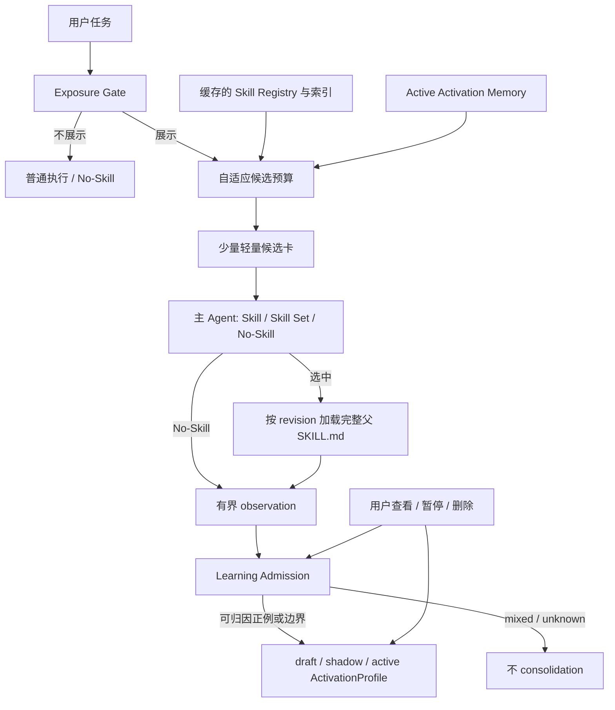

# Skill Cortex：低打扰 Skill Discovery 与可归因 Activation Memory

本项目当前研究：在不把完整 Skill catalog 常驻主 Agent 上下文、不增加 Router LLM 的前提下，
只在 Skill 有明显预期增益时展示最少候选，并且只从经过验证、可归因的真实使用中形成可撤销的
Activation Memory。

一句话原则：

> 少打扰 Agent、少塞上下文、只记真正有效或经过验证的边界经验。

## 当前范围

当前主线回答三个问题：

1. 这次是否需要向 Agent 展示任何 Skill？
2. 如果需要，最少展示哪些 Skill？
3. 哪些证据足以改善以后“什么时候使用该 Skill”的判断？

当前不把 Procedural Memory 作为主线。已有 `CompiledProcedure`、resolver、executor、promotion、
canary 和 lifecycle 代码保留为 **frozen experimental track**：不删除、不扩展、不接入当前入口，
也不计入当前完成标准。重新启用必须新增 ADR，并提供真实宿主质量、成本、维护和安全收益证据。

范围决定见 [ADR-0014](docs/adr/0014-activation-memory-first-scope.md)，完整设计见
[Activation-Memory-first 架构](docs/design/activation-memory-first-architecture.md)。

## 权威阅读顺序

### 当前主线

1. [AGENTS.md](AGENTS.md)：项目安全、范围和协作规则。
2. [最新实施进度审计](docs/reviews/2026-09-08-post-g7-implementation-progress-audit.md)：当前
   Activation-Memory-first 主线与 G1～G7 证据；旧 procedure phase 状态只说明历史 project-local
   验证，不定义当前主线。
3. [ADR-0014：Activation-Memory-first 范围](docs/adr/0014-activation-memory-first-scope.md)。
4. [Activation-Memory-first 架构设计](docs/design/activation-memory-first-architecture.md)。
5. [ADR-0007：Prompt 外 Discovery](docs/adr/0007-prompt-external-skill-discovery.md)。
6. [ADR-0008：Practice Evidence](docs/adr/0008-practice-evidence-and-procedure-promotion.md)：当前只适用
   Practice Event、Activation evidence、污染、版本和删除规则；procedure 部分冻结。
7. [ADR-0013：Selection Memory Context](docs/adr/0013-selection-time-skill-memory-context.md)：目前仍是
   evaluation-only comparator，不代表生产接线。
8. [双记忆数据合同](docs/design/dual-memory-data-contracts.md)：SkillRecord、PracticeEvent 与
   ActivationProfile 继续适用；procedure/runtime 合同冻结兼容。

### 冻结实验方向

只有任务明确涉及已有 procedure 资产的审计、安全修复或历史解释时，才继续读取 ADR-0006、
ADR-0011、ADR-0012、旧双记忆实施计划和 Phase 3～5 报告。不得用这些材料启动新的 procedure
active path。

## 目标运行路径

三个 seam 必须独立：

- **Exposure Gate**：是否展示任何 Skill；
- **Candidate Budget**：展示多少、展示哪些；
- **Learning Admission**：哪些证据可以形成长期 Activation Memory。

不得用一个 maturity/confidence 总分同时控制三者。

## 当前证据边界

- prompt 外 Registry、BM25、Top-K 注入、Practice Store 和 ActivationProfile 链已有 project-local
  实现与测试证据；具体状态以最新 audit 和代码为准。
- Activation Memory calibration 只证明 positive lexical memory 能扩大召回，同时暴露严重
  No-Skill/hard-confuser 污染；它没有通过 promotion。
- Selection Memory held-out 支持候选已存在时的结构化 Memory Context，但 retrieval miss 仍是端到端
  瓶颈；该结果不证明真实 PracticeEvent formation、Pi host production 或自动 promotion。
- 当前 `.pi/extensions/skill-cortex/index.ts` 已接 discovery、Practice observer、D1 用户控制与 D2
  Exposure shadow observation；没有启动 procedure execution，也没有启用 exposure suppress 或 cache。

## 当前实施顺序

1. **D0 范围与文档**：ADR-0014、当前设计、旧文档 applicability 同步。
2. **D1 Learning Admission 与用户控制**：先阻止错误 consolidation，再提供 list/pause/resume/delete。
3. **D2 Exposure、No-Skill、自适应预算与轻量卡**：第一版只做 shadow observation，不写任务类型
   分类器；只有简单 deterministic policy 通过冻结评估后才决定是否 suppress。
4. **D3 Catalog/overlay cache**：Skill 库不变时零重建，变化时正确失效。
5. **D4 受控 active 验证**：分层关闭 admission、exposure、selection、control、cache 与 host E2E gate。

当前已完成 D0。D1 已实现 Admission component、project-local assessment Store，以及真实 Pi 工具入口的
status/list/pause/resume/forget：pause 跨重启持久化并阻止新 evidence 与 induction/promotion；evidence
删除级联 suspend 依赖 profile，profile 删除落 retired tombstone。可信真实宿主 contribution verifier
已新增一个 fail-closed component seam：只有显式注册且精确绑定 parent Skill revision/source 的 verifier，
在所需 Practice step/result 已通过后再次独立复核，才可写 positive assessment；未注册 catalog Skill、
binding drift、重复 registration 或复核不通过均保持零 assessment。新增的 Pi host seam 会从真实
`agent_end.messages` 在内存中提取最终 assistant 输出，并在 PracticeEvent 已落盘后交给任务特定 verifier；
隔离 AgentSession 已验证匹配输出写入、错误输出拒绝。原始 prompt/输出不进入 assessment 或 Store。
当前生产入口已对两个 project-local Skill 注册精确绑定的任务特定 verifier：`skill-cortex-gate-status`
独立重读版本化 gate registry；`markdown-relative-link-audit` 独立重扫 `README.md` 与 `docs/**/*.md` 的
相对文件链接。两者都只在最终严格 JSON 与权威结果完全一致时写 positive assessment。gate-status 已有真实
自用 E2E；Markdown 链接审计已有真实 production entry + AgentSession 正反例，尚未进行真实模型自用。
G1/D1 仍只表示有界任务域 PASS，不代表任意 Skill 已有通用贡献验证。

G4 已通过真实 project-local production entry 验证：pause/resume 跨 entry reload 持久化，pause 后真实
discovery/settled lifecycle 不新增 Exposure/Practice evidence，list 只返回脱敏摘要，forget evidence
同时删除 PracticeEvent/assessment 并级联 suspend profile。G4 在 component + project-local production-entry
host integration 层 PASS；这不代表真实自用部署或 G7 完成。

D2 第一切片已实现 Exposure shadow observation：真实 Pi 入口把每轮 retriever 的有界结构化事实与最终
合法 Skill/No-Skill 选择写入 project-local append-only Store，不保存任务原文。它不返回 active
show/abstain 决策，当前候选注入行为完全不变；active policy 尚未接入。

G2 已新增 evaluation-only 的单一 deterministic policy 冻结 replay：只读取现有 observation 的精确声明
引用、候选数与 top score，不含任务分类规则。calibration 与 frozen replay 均保持基线已召回 Gold 的
necessary exposure recall 为 `6/6`，并把 No-Skill exposure FP 从 `2/4` 降到 `1/4`。这只满足 offline
component 数值条件；heldout 非本轮 untouched，且 production/host/E2E 未验证。依据 ADR-0014，D2 继续
shadow-only，生产候选注入不应用该 policy。

D2 后续两个 shadow 切片也已接线：Candidate Budget 并行记录 K=1/2/3/5 的候选前缀；轻量卡并行记录
作者 description 在 120/240/480 字符预算下的成本与截断数量。两者继续作为 evaluation-only observation，
不改变生产排序或候选卡，也不生成 Memory hint。

G3 的 offline replay 曾支持 K=3 的 retrieval availability，但 2026-09-08 冻结真实模型评测的 180 次调用显示，
所有 K=3 臂的 multi-skill exact-set（55.56%～66.67%）都低于 K=5/full（77.78%）。因此拒绝 K=3
优化并关闭该候选预算决策：生产入口显式固定 K=5 + 完整作者 description，状态记为
`closed_keep_k5_full`。这表示采用已验证基线，不表示 K=3 非劣性门禁通过；description limit 仍不选择。

D3 两层 cache component 已接入现有 discovery service：同一宿主 skills 数组且元数据未变化时，查询复用
Registry 与静态 BM25 索引；active profile 的 revision、status 或 rerank cue 未变化时，discovery 与
`search_skills` 共享派生 overlay snapshot。资源 reload、宿主元数据变化、promotion/suspend/delete、revision
或 cue 变化会分别失效对应层；重建失败不复用旧 catalog，`load_skill` 仍执行当次 source/revision 校验。
隔离的真实 `AgentSession + DefaultResourceLoader` 验证已确认：连续正常 turn 传给
`before_agent_start.systemPromptOptions.skills` 的确是同一数组引用，resource reload 后引用会变化；对应
catalog cache 为 `miss → hit → miss`，source revision 同步变化。因此保留当前 reference + metadata cache key。
旧 revision 拒绝与未 refresh source drift fail-closed 另由 component/adapter 回归覆盖，G5 在 component +
project-local host integration 层 PASS；后续真实自用 Pi 会话证据由 G7 单独关闭。

G6 既有 untouched held-out 与隔离 Pi host seam 已在当前分支重跑：12 条四栏 held-out 全过，
hard-confuser recall/rejection/Gold preservation 与 No-Skill precision 均为 1；active profile revision 匹配、
无 overlay 无损回静态和受控 promotion 均通过。因此 G6 在 component + project-local evaluation host seam
层 PASS。生产入口新增 scope-lock，明确不得配置 `overlayProfiles`/`overlayOptions`；production active
overlay 继续 disabled。G7 关闭的是当前静态 K=5/full + 有界 verifier 的真实自用路径，不把该 overlay 发布。

G7 已在 Pi 0.84.2 的正常项目自动加载路径完成真实自用验证：项目 `.pi/settings.json` 引用唯一
gate-status Skill 源，生产入口显式保持 K=5/full，DeepSeek 经候选选择、`load_skill`、`read` 返回与权威
registry 完全一致的 JSON，并形成独立 verifier pass 的 project-local assessment；原始 prompt 不落盘。
用户级旧 `skill-router.ts` 仅在检测到项目自带 Skill Cortex 时让位，其他项目仍保留原行为。生产入口
静态 import graph 继续禁止 procedure/runtime/compiled observer，G7 状态为 `pass_real_self_use`。

## 不可突破的约束

- 原始 Skill package、作者 description、scope 和权限保持只读；派生资料不得覆盖。
- “任务完成”不等于 Skill 有贡献；positive Memory 必须有版本绑定的 contribution evidence。
- verified negative、near-miss 与 boundary evidence 可以保留，用于 No-Skill 与 hard-confuser 判断。
- `mixed`、`unknown`、evaluation、synthetic、来源不明或失效证据不能进入 active learning。
- 全量 catalog、完整 PracticeEvent 与完整 ActivationProfile 留在 prompt 外。
- 相关不等于必须使用；能直接可靠完成且 Skill 无明显增益时优先 No-Skill。
- Exposure 第一版不得维护“翻译/改写/问答/聊天”等任务规则表，也不得引入额外 Router LLM。
- 召回收益不能抵消 No-Skill、安全、隐私、删除或用户控制回归。
- 所有开发、数据和实验保持 project-local，不修改用户日常 Pi/Codex/Agent 环境或已安装 Skill。
